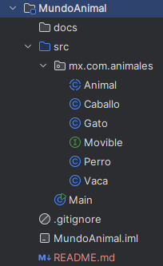

# Mundo animal.
### Proyecto de Java; herencia y polimorfismo.
Hecho por Sergio Estrada Vazquez (Serch/RedMoon73)
CH73
## Descripcion.
Se trata de un proyecto que muestra distintos tipos de animales aprovechando de las caracteristicas
del polimorfismo y la herencia de modo que se pueda practicar programacion orientada a objetos de Java.

fue hecho dentro del bootcamp de generation México como parte de los ejercicios de formacion  de 
desarrollador Java full-stack.

## Estructura.

así se ve el proyecto, y así debería verse en tu PC para que ejecute correctamente de forma local.

La carpeta "MundoAnimal" es solo la carpeta donde esta el proyecto, si lo prefieres, el proyecto puede estar
en cualquier otra carpeta de tu preferencia siempre que sea exclusiva para albergar el proyecto.

## Istrucciones de ejecucion.
1- Descargue el proyecto del repositorio de GitHub: https://github.com/RedMoon73uwu/Mundo-Animal
el proyecto es publico y no deberia tener problema en descargarlo.

2- Abre tu IDE y a continuación selecciona la carpeta de proyecto a abrir. (puede ser inteliJ o Visual Sudio)

3- Literalmente corre el programa:

si es inteliJ, entra a la carpeta src/ presiona Click derecho sobre "Main.java".

Si es Visual Studio Code, puedes hacer lo mismo o si lo prefieres abre un terminal y 
escribe el siguiente comando: 
> >  Java Main.java

4- No hay paso 4, es así de sencillo UwU.

## Ejemplo de salida.

>El nombre del animal es: Frida y tiene: 9 años de edad.

>Woof Woof...

>AUUUUH!

>camina, corre, salta y excava

>

>El nombre del animal es: Mewo y tiene: 4 años de edad.

>Miau (¿Esperando a que pase algo?)

>camina, corre, salta y trepa

>

>El nombre del animal es: Clara y tiene: 7 años de edad.

>Muuuuuuu

>camina, corre, salta y pasta

>

>El nombre del animal es: William y tiene: 12 años de edad.

>HEEE HEEE HE, brrrr

>caminar, saltar y galopar

En honor a Frida, fue mi perrita.

## Preguntas
### - ¿Puedes crear un objeto directamente de animal? ¿porque?
Si, porque a partir de la clase padre que es Animal, salieron las clases perro, gato, vaca y caballo.
y esos mismos podrian tener sus propios objetos (Que sería mi preciosa Frida y los otros animales)
### - ¿Que propiedades se comparten y que comportamiento cambia?
realmente comparten casi todo de las propiedades, todos se mueven, hacen sonidos, tienen nombre y edad
pero lo que cambia es el sonido en especifico que hacen, la forma en que se mueven (algunos pueden hacer cosas que 
otros no) y obviamente todos tienen sus propios nombres y edades asignados en el main.
### - Explica la diferencia entre extends e implements
extends es una extencion, por ejemplo perro es una extencion de animal
implements es una interfaz que puede implementarse, ejemplo, Movible se implementa a perro y gracias a eso
el perro puede correr, caminar y excavar agujeros en tu jardin... Sí, Frida hacía eso (oh no).
### - "Una variable de tipo Animal puede referirse a un objeto de ina clase hija"
si, siempre que esta sea una clase abstarcta y pueda acceder a las clases que partan de esta. (abstracta porque puede
tomar muchas formas... de hecho eso suena mucho a polimorfismo, ahora todo cobra mas sentido)

un momento, esto no es una pregunta.
### - Reto extra: crear Caballo e integralo al arreglo sin cambiar la logica del ciclo.
Debo decír que una ves establecido el sistema de bucle en el main, fue muy facil agregar caballo, realmente
muy util y no tuve que escribir mucho (me tomo menos de 5 minutos)